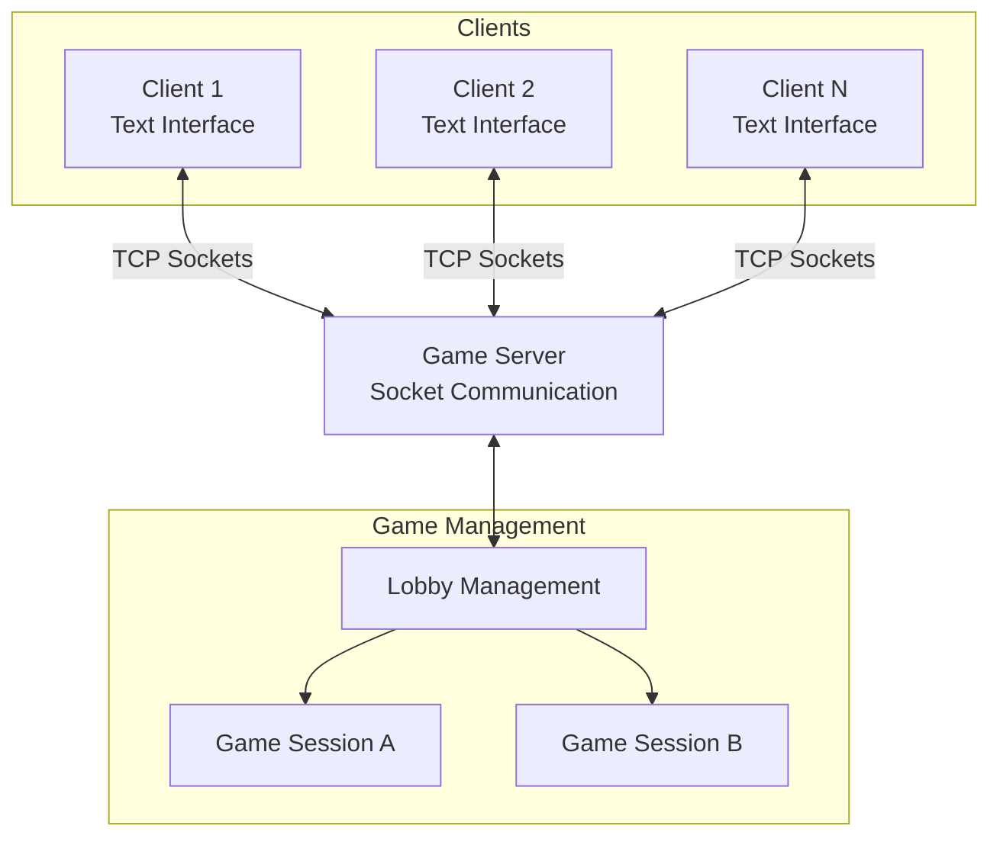

# 🚀 Galaxy Trucker

### A multiplayer digital adaptation of the Galaxy Trucker board game, developed in Java using an MVC architecture and socket-based networking.

**Java 17** · **Maven** · **MVC** · **Socket Programming** · **Client–Server Architecture**

*Software Engineering Project · Politecnico di Milano · Academic Year 2024/2025*

---

## 📖 Overview

Galaxy Trucker is a Java-based digital implementation of the board game **Galaxy Trucker**, developed as the final group project for the *Ingegneria del Software* (Software Engineering) course.

The application implements the complete rules for **Standard Flight, Level II**, allowing multiple players to participate in networked matches through a text-based user interface (TUI).

The project focuses on object-oriented software design, separation of concerns, client-server communication, and multiplayer game management.

### ✨ Project Highlights

| Feature | Implementation |
|---|---|
| 🎮 **Game Rules** | Standard Flight, Level II |
| 🖥️ **User Interface** | Text User Interface (TUI) |
| 🌐 **Multiplayer** | Socket-based client-server communication |
| 🏠 **Multiple Lobbies** | Support for concurrent matches |
| 💾 **Persistence** | Persistent game data |
| 🧩 **Architecture** | Model–View–Controller (MVC) |
| 🧪 **Testing** | 78% line coverage of the Model |

---

## 🏗️ Software Architecture

The application follows the **Model–View–Controller (MVC)** architectural pattern, organizing the codebase into separate components with distinct responsibilities.

- **Model:** Represents the game's entities, state, rules, and underlying logic.
- **View:** Provides the text-based interface through which players interact with the game.
- **Controller:** Coordinates player actions and communication between the interface and game logic.

### 🌐 Client–Server Architecture

The multiplayer system uses Java socket communication to connect clients to a central server.

The server manages game sessions and supports multiple lobbies, allowing separate matches to run concurrently.

The following diagram illustrates the system at a conceptual level.



*The diagram provides a simplified architectural overview rather than a class-by-class representation of the implementation.*

---

## ⚙️ Implemented Features

### 🎮 Game Mechanics

- Implementation of Standard Flight, Level II rules.
- Management of game state and player interactions.
- Game logic organized through an object-oriented class structure.

### 🌐 Networking and Multiplayer

- Socket-based communication between clients and server.
- Centralized management of multiplayer sessions.
- Support for multiple game lobbies and concurrent matches.

### 🖥️ User Interface

- Text-based user interface (TUI).
- Interaction with game functionality through a command-line environment.

### 💾 Data Persistence

- Persistence functionality for maintaining game data.

---

## 🧪 Testing and Quality Assurance

The project includes automated testing of its core game logic.

| Metric | Result |
|---|---:|
| Model line coverage | **78%** |

The testing effort focuses on validating the Model, where the application's core game state and rules are implemented.

*The reported coverage refers specifically to the Model and does not represent total application coverage.*

---

## 🛠️ Technologies

| Technology | Purpose |
|---|---|
| **Java SE 17** | Primary programming language |
| **Apache Maven** | Build and dependency management |
| **Java Sockets** | Client-server networking |
| **MVC** | Application architecture |
| **TUI** | User interaction |

---

## ▶️ Getting Started

### Prerequisites

- Java SE 17 or later.
- Apache Maven, if building from source.
- A terminal or command-line environment.

### Option 1 — Build from Source

Clone the repository:

```bash
git clone https://github.com/raccoglitoredisegale/GalaxyTrucker.git
cd GalaxyTrucker
```

Build the project using Maven:

```bash
mvn clean package
```

Locate the generated executables in the project's deliverables directory.

Start the server:

```bash
java -jar Server.jar
```

Start one or more clients in separate terminals:

```bash
java -jar Client.jar
```

The server uses port **54321** by default. The client requests the server's IP address and port when launched.

If running the client from a different computer, use the server machine's local IP address and ensure that the network and firewall configuration permit the connection.

### Option 2 — Run the Provided JAR Files

Prebuilt server and client JAR files are provided in the repository's deliverables directory.

1. Download `Server.jar` and `Client.jar`.
2. Open a terminal in the directory containing the files.
3. Launch the server, followed by the clients.

On Windows PowerShell, the original project instructions recommend configuring UTF-8 encoding before starting the client:

```powershell
[Console]::OutputEncoding = [System.Text.Encoding]::UTF8
chcp 65001
```

Then run:

```powershell
java -jar Client.jar
```

**Note:** If the source code is modified, rebuild the application using Maven before running the updated JAR files.

---

## 👥 Development Team

Developed as a group project by four students at **Politecnico di Milano**.

| Team Member |
|---|
| Paolo Mornato |
| Matteo Morini |
| Leonardo Miotto |
| Raul Olla |

---

## 💻 My Contributions

My main contributions to the project focused on **software architecture and client-server functionality**, including:

- **Class Design:** Contributed to the design and organization of the application's object-oriented class structure, defining responsibilities and relationships between components.
- **Client–Server Architecture:** Worked on the structure of the multiplayer system, focusing on communication and interaction between clients and the game server.
- **Functionality Implementation:** Contributed to the development and integration of application features within the overall architecture.

---

## 🎓 Academic Context

**University:** Politecnico di Milano  
**Course:** Ingegneria del Software (Software Engineering)  
**Academic Year:** 2024/2025  
**Project Type:** University group project

The project provided practical experience in object-oriented software development, architectural design, distributed application development, and collaborative engineering.
